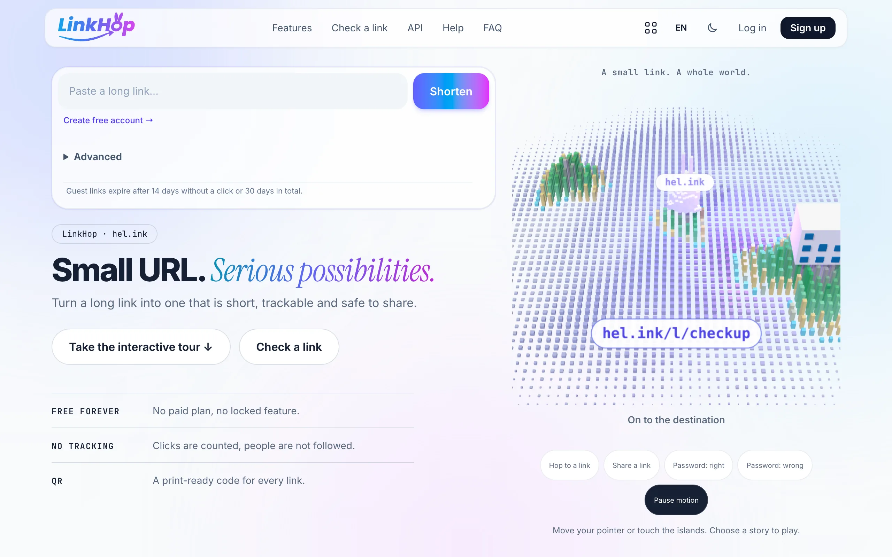
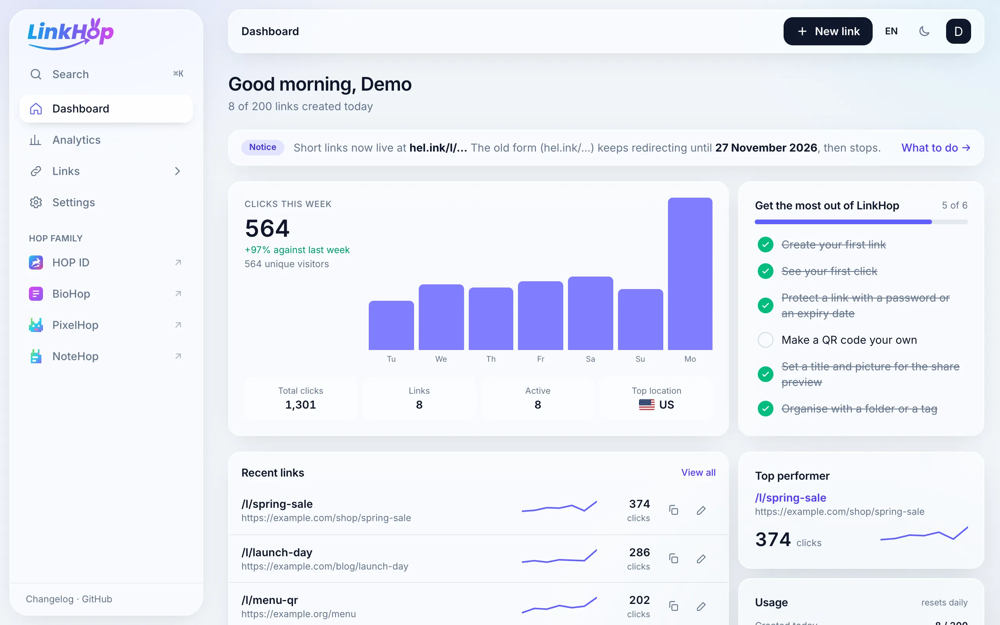
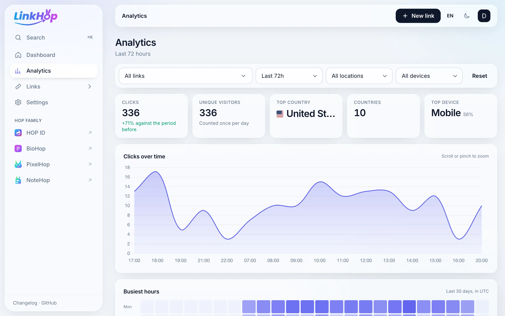
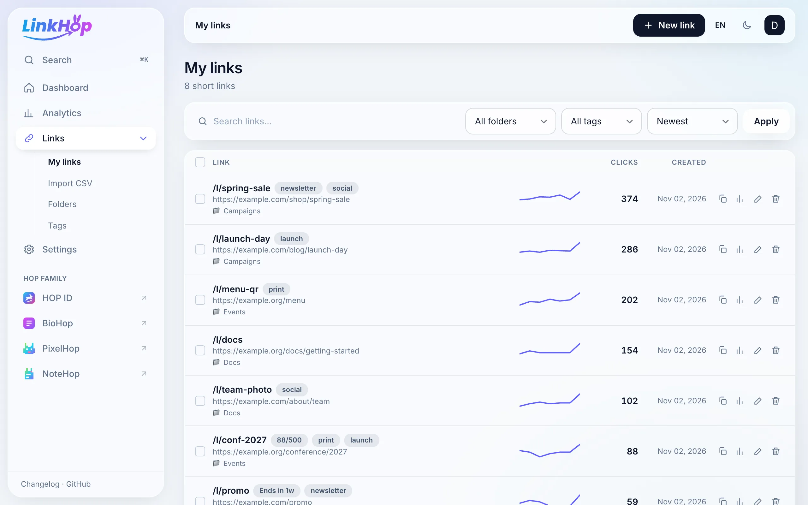

<p align="center">🌐 <a href="README.md">English</a> · <a href="README.zh-CN.md">简体中文</a> · <b>Deutsch</b> · <a href="README.id.md">Bahasa Indonesia</a> · <a href="README.ja.md">日本語</a> · <a href="README.pt-BR.md">Português (Brasil)</a> · <a href="README.es.md">Español</a> · <a href="README.fr.md">Français</a> · <a href="README.ru.md">Русский</a></p>

<p align="center"><picture><source media="(prefers-color-scheme: dark)" srcset="docs/readme/home-dark.webp"></picture></p>

<p align="center">
  <b>Kurzlinks, QR-Codes und Klick-Statistiken.<br>Kostenlos, Open Source und selbst hostbar.</b>
</p>

<p align="center">
  <a href="https://link.hel.ink"><b>LinkHop ausprobieren</b></a> ·
  <a href="https://navi-crwn.github.io/LinkHop/">Website</a> ·
  <a href="#installation">Installation</a> ·
  <a href="#api">API</a> ·
  <a href="#faq">FAQ</a> ·
  <a href="CHANGELOG.md">Changelog</a> ·
  <a href="CREDITS.md">Credits</a> ·
  <a href="SECURITY.md">Sicherheit</a>
</p>

<p align="center">
  
  
  
  
  
</p>

LinkHop kürzt Links, zählt die Klicks und erstellt zu jedem Link einen QR-Code. Es ist der Link-Kürzer der HOP-Familie und läuft unter [link.hel.ink](https://link.hel.ink). Kurzlinks öffnen sich unter `hel.ink/l/slug`.

Links kürzen kann jeder ohne Konto. Eine kostenlose HOP ID behält deine Links und zeigt ihre Statistiken. HOP ID ist das eine Konto für alle HOP-Apps; es liegt im [Hub](https://github.com/navi-crwn/HEL.ink) unter `hel.ink` und `hub.hel.ink`. LinkHop hat keine eigenen Seiten für Anmeldung, Registrierung oder Profil: Der Hub meldet dich an und schickt dich mit einem kurzlebigen Ticket zurück, und die Apps teilen sich eine Datenbank.

## HOP-Familie

| App | Adresse | Repository | Was sie tut |
| --- | --- | --- | --- |
| **HOP ID** | [hel.ink](https://hel.ink) · Konten unter `hub.hel.ink` | [navi-crwn/HEL.ink](https://github.com/navi-crwn/HEL.ink) | Ein Konto für jede HOP-App. |
| **LinkHop** | [link.hel.ink](https://link.hel.ink) · `hel.ink/l/…` | [navi-crwn/LinkHop](https://github.com/navi-crwn/LinkHop) | Kurzlinks, QR-Codes und Klick-Statistiken. |
| **BioHop** | [bio.hel.ink](https://bio.hel.ink) · `hel.ink/b/…` | [navi-crwn/BioHop](https://github.com/navi-crwn/BioHop) | Eine Link-in-Bio-Seite für alles, was du machst. |
| **PixelHop** | [pixel.hel.ink](https://pixel.hel.ink) · `p.hel.ink/…` | [navi-crwn/PixelHop](https://github.com/navi-crwn/PixelHop) | Bilder hosten mit Alben und Direktlinks. |
| **NoteHop** | [note.hel.ink](https://note.hel.ink) · `n.hel.ink/…` | [navi-crwn/NoteHop](https://github.com/navi-crwn/NoteHop) | Verschlüsselte Notizen, die du per Link teilst. |
| **Imperium** | privat (nur Eigentümer) | privat | Das HOP-Kontrollzentrum. |

Für jedes Konto ist alles enthalten, es gibt keine Bezahlstufe. Der Code steht unter der MIT-Lizenz, du kannst ihn also auch auf deinem eigenen Server und deiner eigenen Domain betreiben.

<p align="center"><picture><source media="(prefers-color-scheme: dark)" srcset="docs/readme/dashboard-dark.webp"></picture></p>

Screenshots von Seiten nach der Anmeldung zeigen erfundene Demodaten, kein echtes Konto.

## Funktionen

- Kurzlinks mit zufälligem oder eigenem Slug (3 bis 255 Zeichen), optionalem Passwort, Ablaufdatum und einem QR-Code als PNG, SVG oder JPG.
- Link-Limits: eine Startzeit, eine maximale Klickzahl, eine Ersatzadresse für den Fall, dass der Link abgelaufen ist oder keine Klicks mehr übrig sind, und der Weiterleitungstyp 301, 302, 307 oder 308.
- Routing: bis zu 20 Regeln, die Besucher nach Land, Sprache, Gerät, Betriebssystem oder Browser woandershin schicken, und ein A/B-Split aus 2 bis 5 Adressen mit Gewichten. Ein Kampagnen-Tag-Builder (UTM) füllt die `utm_*`-Parameter aus.
- In der App öffnen: Auf iOS und Android kann ein Link zuerst die installierte App versuchen, mit dem App Store oder Google Play als Ausweichziel.
- Statistiken: Klicks, eindeutige Besucher, Länder und Städte, Geräte, Browser, In-App-Browser, Referrer sowie QR-Scans im Vergleich zu direkten Klicks. Der Zeitraum wird mit dem davor verglichen. Klickprotokolle pro Klick werden 30 Tage aufbewahrt.
- Ordnung halten: Ordner, Tags, Suche, Massenaktionen, Kommentare zu einem Link, CSV-Import mit bis zu 500 Zeilen und eine Befehlspalette mit Strg oder Cmd + K. Unter Einstellungen gibt es einen CSV-Export deiner Links samt Statistiken.
- Link-Prüfung unter `/check`: Füge einen `hel.ink`-Link ein und sieh das Ziel, bevor du ihn öffnest. Es wird nichts angeklickt oder gezählt.
- Zielüberwachung: Einmal am Tag fragt LinkHop bei jedem aktiven Ziel nach, ob es noch antwortet, und schreibt dem Eigentümer nach drei fehlgeschlagenen Prüfungen in Folge eine E-Mail. In den Einstellungen lässt sich das abschalten.
- Inhaltswarnung: Ein Link kann als sensibel oder nur für Erwachsene markiert werden, dann sehen Besucher einen Hinweis, bevor sie weitergehen.
- Missbrauchsschutz: Ratenbegrenzung und Kontingente, eine Domain-Sperrliste, IP-Sperren, Proxy- und VPN-Prüfungen bei Besuchern, ein Meldeformular und ein stündlicher Scan nach Phishing, Betrug und anderen schädlichen Links, optional mit Abfragen bei Google Safe Browsing und URLhaus.
- API und Webhooks: eine REST-API mit Tokens mit Berechtigungsbereichen und Idempotenzschlüsseln, signierte Webhooks für fünf Link-Ereignisse und eine ShareX-Konfiguration.
- Neun Sprachen: English, 简体中文, Deutsch, Bahasa Indonesia, 日本語, Português (Brasil), Español, Français und Русский. Mit `?lang=de` an einer beliebigen Seite wechselst du die Sprache; die Wahl wird in einem Cookie gespeichert.
- Datenschutz: keine Werbung, keine Tracker von Dritten und keine Skripte, Schriften oder Bilder von einem CDN. Die Bibliotheken sind gebündelt oder liegen in `public/vendor`. Die zwei übrigen Fremd-Hosts sind Cloudflare Turnstile im Gastformular und OpenStreetMap-Kacheln unter der Analytics-Karte.
- Selbst hosten: ein Installationsbefehl, Skripte zum Aktualisieren und Deinstallieren, nächtliche Backups und eine signierte Admin-API für das HOP-Kontrollzentrum.

Bio-Seiten (`hel.ink/b/du`) werden in [BioHop](https://github.com/navi-crwn/BioHop) erstellt, nicht in LinkHop. Den einen Fall, in dem LinkHop sie noch ausliefert, beschreibt der Abschnitt [Bio-Seiten](#bio-seiten).

<p align="center"><picture><source media="(prefers-color-scheme: dark)" srcset="docs/readme/analytics-dark.webp"></picture></p>

<p align="center"><picture><source media="(prefers-color-scheme: dark)" srcset="docs/readme/links-dark.webp"></picture></p>

## Wo was liegt

| Was | URL |
| --- | --- |
| Kurzlink | `hel.ink/l/slug` |
| Alte Kurzlink-Form | `hel.ink/slug`, leitet bis zum 27. November 2026 auf `hel.ink/l/slug` weiter (`LEGACY_SLUG_UNTIL`) |
| Bio-Seite (BioHop) | `hel.ink/b/name` |
| Dashboard und API | `link.hel.ink`, Anmeldung über den Hub unter `hub.hel.ink` |
| Dein Konto | `hub.hel.ink`: Profil, Passwort, Zwei-Faktor, API-Tokens, Datenexport, Konto löschen |

Kurzlinks sind am 28. Oktober 2026 von `hel.ink/slug` nach `hel.ink/l/slug` umgezogen, damit `hel.ink` mehrere HOP-Apps beherbergen kann. Gelöscht wurde nichts. Dashboard, QR-Codes, die API und der Konto-Export zeigen die neue Form. Auf deiner eigenen Installation ist der öffentliche Host `PUBLIC_URL` (Standard: `APP_URL`), und `php artisan links:announce-migration` schickt jedem Link-Eigentümer seine Links in der neuen Form per E-Mail (`--reminder` verschickt die zweite Mail).

## Installation

Das Installationsskript prüft deinen Rechner, stellt ein paar Fragen und kann den HOP-ID-Hub neben LinkHop einrichten:

```bash
curl -fsSL https://raw.githubusercontent.com/navi-crwn/LinkHop/main/install.sh | bash
```

Aus einem Klon startest du `./install.sh`. Zum Aktualisieren führst du `./update.sh` aus, zum Entfernen von LinkHop `./uninstall.sh`. Mit `--yes` gelten alle Standardwerte, mit `--dry-run` siehst du die Schritte, ohne sie auszuführen, und `--help` zeigt die übrigen Optionen.

- `install.sh` braucht PHP 8.2 oder neuer (es nutzt `php8.3`, wenn das installiert ist; mit `PHP_BIN` wählst du ein anderes), Composer, Node.js 20 oder neuer und eine Datenbank: SQLite oder MySQL/MariaDB. Es schreibt eine private `.env` und eine `start.sh`, die Webserver, Queue-Worker und Scheduler startet.
- `update.sh` kopiert zuerst die Datenbank nach `backups/` (SQLite oder MySQL/MariaDB), schaltet die Seite in den Wartungsmodus, holt den neuen Code, baut neu, migriert und spielt die alte Version wieder ein, wenn ein Schritt vor den Migrationen fehlschlägt. Lässt sich keine Datenbankkopie anlegen, bricht es ab; mit `--no-backup` läuft es ohne Kopie weiter.
- `uninstall.sh` entfernt die installierten Pakete und gebauten Dateien und behält deine `.env`, die Datenbank, Uploads und Logs. Mit `--purge` werden auch diese gelöscht, vorher musst du den Namen der Seite eintippen.

> [!NOTE]
> LinkHop führt Konten in einem HOP-ID-Hub ([HEL.ink](https://github.com/navi-crwn/HEL.ink)); einen Betrieb ohne Hub gibt es nicht. Das Installationsskript kann einen Hub neben LinkHop einrichten (Standard, etwa eine Minute) oder sich mit einem Hub verbinden, den du schon betreibst. Um den Hub und mehrere Apps auf einmal zu installieren, nutze `install-family.sh` aus dem HEL.ink-Repository.

### Manuelle Installation

Du brauchst PHP 8.2 oder neuer mit den üblichen Laravel-Erweiterungen und `gd` oder `imagick` (PNG-QR-Codes), Composer, Node.js 20.19 oder neuer und eine Datenbank. Der [Hub](https://github.com/navi-crwn/HEL.ink) muss auf derselben Datenbank laufen: Er besitzt die Konto-Tabellen (`users`, `api_tokens` und weitere) und meldet die Leute an.

```bash
# Die gemeinsamen Pakete hop/auth, hop/ui und hop/safety kommen über Composer von GitHub.
git clone https://github.com/navi-crwn/LinkHop.git
cd LinkHop
composer install --no-dev --optimize-autoloader
npm ci && npm run build

cp .env.example .env
php artisan key:generate          # danach .env bearbeiten, siehe unten
php artisan migrate --force       # nur die Tabellen dieser App
php artisan storage:link
php artisan serve --port=8001
```

Für lokale Arbeit setzt du `APP_ENV=local`, `APP_URL=http://localhost:8001`, `PUBLIC_URL=http://localhost:8001`, `HOP_HUB_URL=http://localhost:8000` (der Hub mit `php artisan serve`) und `SESSION_SECURE_COOKIE=false`, und im Hub `LINKHOP_URL=http://localhost:8001`. Wer LinkHop als Gast öffnet, landet bei der Anmeldung des Hubs und kommt angemeldet zurück.

In Produktion müssen zwei Dinge laufen: ein Queue-Worker (`php artisan queue:work --tries=3`) und der Scheduler (eine Cron-Zeile `* * * * * cd /pfad/zu/linkhop && php artisan schedule:run`). Der Scheduler führt den Missbrauchs-Scan, die Zielüberwachung, Webhook-Wiederholungen, die Datenschutz-Bereinigung, das Löschen von Gast-Links und das Backup aus.

**Besitz der Datenbank.** Jede HOP-App führt gegen die gemeinsame Datenbank nur ihre eigenen Migrationen aus. Die von LinkHop liegen in `database/migrations`. Die Geschichte der Konto-Tabellen steht in `database/migrations-archive` und wird nicht mehr ausgeführt; die Tests bauen das Schema daraus. Führe `migrate:fresh` nie gegen eine Datenbank aus, die der Hub nutzt.

<details>
<summary><b>Einstellungen in <code>.env</code></b></summary>

Die Datei `.env.example` listet alles auf. Diese Einstellungen wirst du am ehesten anfassen.

| Einstellung | Bedeutung |
| --- | --- |
| `APP_URL` | Das Dashboard und die API (`https://link.hel.ink` beim gehosteten Dienst). |
| `PUBLIC_URL` | Wo Kurzlinks, QR-Codes und die Sitemap erreichbar sind (`https://hel.ink`). Bei einer Installation mit einem Host derselbe Wert wie `APP_URL`. |
| `HOP_APP`, `HOP_HUB_URL`, `HOP_SSO_SECRET` | Die Verbindung zum Hub. `HOP_APP` ist `linkhop`; das Secret ist dasselbe mit mindestens 32 Zeichen wie in der `.env` des Hubs. Anmeldung, Google-Login, Zwei-Faktor und Passwort-Reset gehören dem Hub, hier ist dafür nichts einzustellen. |
| `DB_*` | Dieselbe Datenbank wie beim Hub. |
| `MAIL_*` | Ausgehende E-Mail: Hinweise an Link-Eigentümer, Zielüberwachung und Backup-Meldungen. |
| `TURNSTILE_SITE_KEY`, `TURNSTILE_SECRET_KEY` | Cloudflare Turnstile im Gast-Kürzer und im Meldeformular. In Produktion lehnt das Gastformular ohne Secret Key jede Eingabe ab. |
| `GUEST_LINK_IDLE_DAYS`, `GUEST_LINK_MAX_DAYS` | Gast-Links werden nach 14 Tagen ohne Klick gelöscht, spätestens nach 30 Tagen. Der Server kann diese Werte nur verkürzen. |
| `LIMIT_*` | Kontingente aus `config/limits.php`, zum Beispiel 10 Links pro Minute und 200 pro Tag je Adresse, 200 pro Tag und 1000 aktive Links je Konto. |
| `SAFE_BROWSING_KEY`, `URLHAUS_AUTH_KEY` | Optionale Abfragen für den Missbrauchs-Scan. |
| `GEOLITE_LICENSE_KEY` | Optional. Ohne ihn lädt `geolite:update` die kostenlosen DB-IP-Lite-Datenbanken. |
| `BIO_ENABLED`, `BIOHOP_URL`, `PIXELHOP_URL` | Das mitgelieferte Bio-Paket und die Adressen der anderen Apps. |
| `HOP_CONTROL_URL` | Wohin `/admin` Admins schickt: das HOP-Kontrollzentrum. |
| `LEGACY_SLUG_UNTIL` | Das Datum, an dem die alte Weiterleitung `hel.ink/slug` endet. Bei einer neuen Installation leer lassen. |
| `TRUSTED_PROXIES` | Die Adressen des Reverse-Proxys oder `cloudflare`. |
| `SENTRY_LARAVEL_DSN`, `BACKUP_DISKS` | Fehlerverfolgung und die Datenträger, auf die das Backup geschrieben wird (Standard `local`). |

**Standort der Besucher.** Land und Stadt kommen aus einer lokalen DB-IP-Lite-Datenbank, die `geolite:update` wöchentlich aktualisiert. Hat sie für eine öffentliche Adresse keine Antwort, fragt LinkHop bis zu zwei Web-Dienste: freeipapi.com, ip-api.com, ipapi.co, ipinfo.io oder abstractapi.com. Die Adresse des Besuchers wird nur als Hash mit Schlüssel gespeichert.

**Backups.** Der Scheduler führt jeden Tag um 02:45 Uhr `backup:run` aus. Das Archiv enthält die Datenbank, `storage/app/public` und die `.env` und geht auf die Datenträger aus `BACKUP_DISKS`. Ein MySQL- oder MariaDB-Backup braucht `mysqldump` auf dem Server. Die `.env` enthält deine Secrets: Schütze den Backup-Datenträger oder setze `BACKUP_ARCHIVE_PASSWORD`.

**Hinter Cloudflare.** LinkHop sendet eine Content Security Policy, die Skripten mit dem Nonce der Seite vertraut. Cloudflares Email Address Obfuscation (Scrape Shield) und Rocket Loader (Speed, Optimization) fügen eigene Skripte ohne diesen Nonce ein, deshalb blockieren Browser sie, und die Blockierungen landen in `storage/logs/csp-*.log`. Schalte beide im Cloudflare-Dashboard ab. LinkHop braucht sie nicht. Sie in die Policy aufzunehmen, würde bei einer Nonce-Policy nicht funktionieren, weil `'strict-dynamic'` Host-Freigaben ignoriert.

**Ein Host.** Der gehostete Dienst teilt LinkHop auf: das Dashboard unter `link.hel.ink` und die Kurzlinks unter `hel.ink/l/`. Die nginx-Regeln für diese Aufteilung liegen im Hub-Repository unter `deploy/nginx/`. Bei einem einzigen Host setzt du `APP_URL` und `PUBLIC_URL` auf denselben Wert.

</details>

## Benutzung

**Einen Link kürzen.** Füge die lange Adresse ein, wähle optional einen Slug, ein Passwort oder ein Ablaufdatum, drücke „Shorten“ und kopiere das Ergebnis. Auf der Startseite findest du die Gast-Optionen unter „Advanced“; nach der Anmeldung bietet „New link“ alle oben genannten Optionen.

**Bio-Seiten.** Melde dich bei [bio.hel.ink](https://bio.hel.ink) mit derselben HOP ID an, wähle einen Namen und teile `hel.ink/b/deinname`.

## API

API-Tokens erstellst du im Hub (HOP ID, Settings, API), und sie funktionieren in jeder HOP-App. LinkHop liest sie aus der gemeinsamen Tabelle `api_tokens`. Ein Token hat Berechtigungsbereiche (Scopes): `link:create`, `link:read` und `link:delete`. Ein Token aus der Zeit vor den Scopes hat keine und darf alles. Die API antwortet unter `link.hel.ink/api` und unter `hel.ink/api`, das bis zum 27. November 2026 dorthin weiterleitet. Das Limit gilt pro Token: 100 Anfragen pro Stunde, sofern das Token nichts anderes festlegt.

Einen Kurzlink erstellen (`link:create`). BioHop ruft das auf, wenn ein Bio-Block einen Kurzlink möchte.

```bash
curl -X POST https://link.hel.ink/api/shorten \
  -H "Authorization: Bearer YOUR_TOKEN" \
  -H "Content-Type: application/json" \
  -d '{"url": "https://example.com", "alias": "my-link"}'
```

| Feld | | |
| --- | --- | --- |
| `url` | Pflicht | Eine vollständige Adresse mit `http://` oder `https://`, bis zu 2048 Zeichen. Wird abgelehnt, wenn die Sicherheitsprüfung sie beanstandet. |
| `alias` | optional | Der Slug: 3 bis 255 Zeichen aus `A-Z a-z 0-9 _ -`. Reservierte Wörter und vergebene Slugs werden abgelehnt. Zufällig, wenn weggelassen. |
| `folder` | optional | Ein Ordnername im Konto. Wird angelegt, wenn er nicht existiert. |
| `password` | optional | 4 bis 50 Zeichen; Besucher müssen es eintippen. |
| `expires_at` | optional | Ein ISO-Datum mit Uhrzeit in der Zukunft. |
| `starts_at` | optional | Ein Zeitpunkt, vor dem Besucher „Not live yet“ sehen. |
| `max_clicks` | optional | Der Link endet nach so vielen Klicks (1 bis 10.000.000). |
| `fallback_url` | optional | Wohin Besucher nach dem Ablaufdatum oder dem Klick-Limit kommen. Darf kein anderer Kurzlink sein. |
| `redirect_type` | optional | `301`, `302` (Standard), `307` oder `308`. |
| `content_warning`, `warning_reason` | optional | `none`, `sensitive` oder `adult`, und eine Notiz von bis zu 255 Zeichen, die Besucher sehen. |
| `routing_rules`, `ab_variants`, `app_links` | optional | Routing nach Besucher, ein A/B-Split und Deep Links. Die Formate stehen auf der API-Docs-Seite des Dashboards. |

```json
HTTP 201
{"success": true,
 "data": {"url": "https://hel.ink/l/my-link", "slug": "my-link", "target_url": "https://example.com",
          "status": "active", "content_warning": "none", "warning_reason": null,
          "created_at": "2026-11-02T10:00:00+00:00", "expires_at": null, "starts_at": null,
          "max_clicks": null, "fallback_url": null, "routing_rules": [], "ab_variants": [],
          "app_links": null, "redirect_type": "302"},
 "message": "Link created successfully"}
```

Fehler haben immer dieselbe Form, `{"success": false, "error": "…", "message": "…"}`. `401` bedeutet unbekanntes oder abgelaufenes Token, `403` fehlender Scope oder gesperrtes oder nicht bestätigtes Konto, `422` einen Validierungsfehler (`messages` listet die Felder) und `429` ein Kontingent oder Ratenlimit.

Sende bei `POST /api/shorten` einen `Idempotency-Key`-Header, um sicher zu wiederholen. Derselbe Schlüssel mit demselben Body liefert die erste Antwort zurück (`Idempotent-Replayed: true`) und legt nichts doppelt an. Derselbe Schlüssel mit anderem Body ergibt `422`. Schlüssel werden 24 Stunden aufbewahrt.

Einen Link lesen (`link:read`) kannst du mit `GET /api/links/{slug}`; das liefert dieselben `data` plus `clicks`. Löschen (`link:delete`) geht mit `DELETE /api/links/{slug}`. Beide antworten mit `404` auf einen Slug, der nicht zum Konto des Tokens gehört.

Webhooks richtest du in den Einstellungen ein: bis zu fünf https-Adressen, jede wird bei `link.created`, `link.updated`, `link.deleted`, `link.limit_reached` und `link.expired` aufgerufen. Eine Nachricht trägt `X-LinkHop-Signature`, einen HMAC-SHA256 aus Zeitstempel und Body. Eine fehlgeschlagene Zustellung wird nach 1 Minute, 5 Minuten, 30 Minuten und 2 Stunden wiederholt, und ein Webhook, der zehn Zustellungen in Folge nicht schafft, wird abgeschaltet.

Eine ShareX-Konfiguration lässt sich auf der API-Docs-Seite des Dashboards herunterladen.

## FAQ

**Ist es kostenlos?** Ja. Es gibt keinen Bezahltarif und keine gesperrte Funktion.

**Brauche ich ein Konto?** Nein. Jeder kann einen Link ohne Konto kürzen. Gast-Links werden nach 14 Tagen ohne Klick gelöscht, spätestens nach 30 Tagen. Eine kostenlose HOP ID behält deine Links, zeigt ihre Statistiken und meldet dich auch bei den anderen HOP-Apps an.

**Wo ist meine Bio-Seite?** In BioHop, unter `hel.ink/b/` und dem Namen, den du wählst. Bearbeiten kannst du sie auf [bio.hel.ink](https://bio.hel.ink).

**Was speichert ein Klick?** Die Zeit, Land und Stadt, Gerät, Browser und Referrer sowie einen Hash mit Schlüssel aus Adresse und Browser, der sich jeden Tag ändert und zum Zählen eindeutiger Besucher dient. Die Adresse selbst wird nicht gespeichert, und Klickprotokolle werden nach 30 Tagen gelöscht.

**Wie melde ich einen schlechten Link?** Über das Meldeformular unter `/report-abuse`. Meldungen landen in der Missbrauchs-Warteschlange des HOP-Kontrollzentrums, neben den Funden des automatischen Scans.

**Kann ich meine eigene Domain nutzen?** Ja, indem du eine eigene Kopie neben dem Hub betreibst. `APP_URL` ist der Host des Dashboards, `PUBLIC_URL` der Host für Kurzlinks und `HOP_HUB_URL` der Hub.

### Bio-Seiten

Auf hel.ink gehören Bio-Seiten BioHop. Eine Einzelserver-Installation ohne BioHop kann sie weiterhin aus dem mitgelieferten Paket `hop/bio` (`packages/bio`) ausliefern, wenn du `BIO_ENABLED=true` setzt. Mit BioHop daneben lässt du es auf `false`: Dann registriert es keine Routen und braucht keine Tabellen. `php artisan db:seed --class=ExampleBioSeeder` legt auf einer Entwicklungsinstallation eine Beispiel-Bio-Seite und einige Beispiel-Kurzlinks an.

## Technik

| Schicht | Technologien |
| --- | --- |
| Backend | Laravel 12, PHP 8.2 oder neuer, SQLite oder MySQL/MariaDB |
| Frontend | Tailwind CSS 4, Alpine.js 3, Vite 7, GSAP, Lenis und Three.js für die Startseite |
| Diagramme und Karten | Chart.js 4, Leaflet 1.9 mit OpenStreetMap-Kacheln |
| Konten | HOP ID im Hub, über `hop/auth` (SSO-Client sowie die Middleware `hop.auth` und `hop.token`) |
| Gemeinsame Pakete | `hop/auth`, `hop/ui` (App-Umschalter, Schriften), `hop/safety` (URL- und Inhaltssicherheit), `hop/bio` (gebündelt in `packages/bio`) |
| Dienste | Cloudflare Turnstile, DB-IP Lite und optionale Web-Dienste für den Besucherstandort, optional Google Safe Browsing und URLhaus, Sentry |

| Ordner | Was darin liegt |
| --- | --- |
| `app/`, `routes/`, `resources/` | Die Laravel-App: Controller, Modelle, Blade-Views, Skripte und Styles. |
| `config/hop.php`, `config/limits.php`, `config/shortener.php` | Die Liste der HOP-Familie (dieselbe `apps`-Liste wie im Hub), Link-Kontingente sowie Einstellungen für Gast-Links, Slugs und Zielüberwachung. Sicherheitsmuster und Schwellenwerte kommen aus `hop/safety` (`config('safety')`). |
| `database/migrations/`, `database/migrations-archive/` | Die eigenen Tabellen von LinkHop und die Geschichte der Konto-Tabellen (jetzt Sache des Hubs, wird nicht ausgeführt). |
| `lang/` | Die neun Sprachdateien. |
| `tests/` | Pest- und PHPUnit-Tests (`php artisan test`) sowie die Browser-Tests mit simulierten Nutzern in `tests/e2e/` ([so laufen sie](tests/e2e/README.md)). |
| `docs/` | Die Website unter [navi-crwn.github.io/LinkHop](https://navi-crwn.github.io/LinkHop/). `docs/readme/` enthält die README-Screenshots; `scripts/readme-images.mjs` nimmt sie neu auf. |
| `scripts/` | Hilfsskripte: `build-changelog.py` (der Changelog in der App), `check-hop-family.sh` (die Familientabelle der englischen README) und `readme-images.mjs`. |

Jede Abhängigkeit und ihre Lizenz steht in [CREDITS.md](CREDITS.md).

## Mitmachen

1. Forke das Repository und lege einen Branch an.
2. Nimm deine Änderung vor und führe `vendor/bin/pint` und `php artisan test` aus.
3. Pushe und öffne einen Pull Request gegen `main`.

Bitte schreibe Tests für neues Verhalten. Sicherheitsprobleme meldest du privat, wie in [SECURITY.md](SECURITY.md) beschrieben; für alles andere nutze die Issue-Vorlagen.

## Lizenz

MIT. Siehe [LICENSE](LICENSE).

---

<p align="center">Von <a href="https://github.com/navi-crwn">Ivan Novskies (@navi-crwn)</a> · <a href="https://link.hel.ink">LinkHop</a> · <a href="https://navi-crwn.github.io/LinkHop/">Website</a></p>
