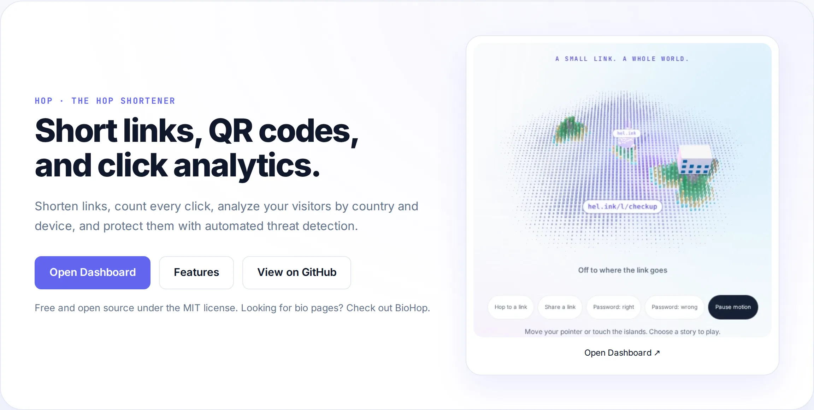

<p align="center">🌐 <a href="README.md">English</a> · <a href="README.zh-CN.md">简体中文</a> · <a href="README.de.md">Deutsch</a> · <a href="README.id.md">Bahasa Indonesia</a> · <a href="README.ja.md">日本語</a> · <a href="README.pt-BR.md">Português (Brasil)</a> · <b>Español</b> · <a href="README.fr.md">Français</a> · <a href="README.ru.md">Русский</a></p>

# LinkHop — LinkHop · Enlaces cortos, códigos QR y analítica de clics

<p align="center">
  <a href="LICENSE"></a>
  <a href="https://github.com/navi-crwn/LinkHop/actions/workflows/tests.yml"></a>
</p>

<p align="center"><picture><source media="(prefers-color-scheme: dark)" srcset="docs/readme/hero-en-dark.webp"></picture></p>

<p align="center"><b>Acorta enlaces, cuenta cada clic, analiza a tus visitantes por país y dispositivo, y protégelos con detección automática de amenazas.</b></p>

<p align="center">
  <a href="https://link.hel.ink">link.hel.ink</a> ·
  <a href="#run">Instálalo tú mismo</a> ·
  <a href="#features">Características</a> ·
  <a href="#faq">Preguntas frecuentes</a> ·
  <a href="#family">Familia HOP</a>
</p>

---

Instala con un solo comando (primero revisa tu equipo, hace unas pocas preguntas y puede instalar el hub HOP ID por ti):

```bash
curl -fsSL https://raw.githubusercontent.com/navi-crwn/LinkHop/main/install.sh | bash
```

Desde un clon: `./install.sh` · actualizar: `./update.sh` · quitar: `./uninstall.sh`. Con `--yes` se usan todos los valores por defecto; `--help` lista las opciones.

## El acortador de HOP

Acortador de enlaces rápido y respetuoso con la privacidad con slugs personalizados, códigos QR y análisis profundo. Parte de HOP.

<a id="features"></a>

## Características

- **Acortamiento ultrarrápido**: Slugs personalizados o identificadores aleatorios servidos en hel.ink/l/{slug} con baja latencia.
- **Códigos QR dinámicos**: Genera códigos QR en SVG/PNG de alta resolución para imprimir o compartir en línea.
- **Analítica profunda de clics**: Monitorea países (GeoIP), dispositivos, navegadores, sistemas operativos y referentes en tiempo real.
- **Seguridad automatizada**: Escaneo proactivo a través de hop/safety y listas negras compartidas para proteger a tu audiencia.
- **Controles detallados**: Configura fecha de caducidad, límite de clics y contraseña para enlaces sensibles.
- **Carpetas y etiquetas**: Organiza tus enlaces en carpetas y etiqueta campañas para una gestión ordenada.
- **Inicio de sesión con HOP ID**: Inicia sesión con tu cuenta central HOP ID sin credenciales redundantes.
- **API REST para desarrolladores**: API completa con tokens de autenticación por ámbitos para automatizar tus flujos.

<a id="run"></a>

## Instala tu propio LinkHop

LinkHop se ejecuta sobre una infraestructura moderna de PHP y Laravel.

```bash
git clone https://github.com/navi-crwn/LinkHop.git
cd LinkHop
composer install
cp .env.example .env && php artisan key:generate
php artisan migrate
npm install && npm run build
php artisan serve
```

<a id="faq"></a>

## Preguntas frecuentes

**¿Qué pasó con las páginas link-in-bio?**
Las páginas bio se han trasladado a BioHop (bio.hel.ink) como una aplicación dedicada. Los enlaces antiguos redirigen automáticamente.

**¿Puedo usar slugs personalizados?**
Sí, los usuarios registrados pueden elegir slugs propios siempre que estén disponibles.

**¿Cómo se protege la privacidad en las estadísticas?**
Los datos se agregan sin almacenar información personal ni vender perfiles, y los registros se limpian periódicamente.

**¿Es LinkHop gratuito y de código abierto?**
Sí, LinkHop se distribuye bajo la licencia permisiva MIT.

**¿Puedo acortar el enlace de una nota cifrada de NoteHop?**
No. La clave de una nota cifrada es la parte de su enlace que va después del `#`, y un enlace corto la guardaría en el servidor, así que LinkHop rechaza estos enlaces: comparte el enlace de NoteHop tal como está (su botón de compartir ya da una dirección corta).

<a id="family"></a>

## Autoalojamiento

<!-- self-hosting:start -->
Todo lo que LinkHop necesita está en repositorios públicos: ningún repositorio privado, ningún token y ninguna cuenta en hel.ink. Los detalles están en la guía de la familia: [docs/self-hosting.md](https://github.com/navi-crwn/HEL.ink/blob/main/docs/self-hosting.md) (en inglés).

| Pieza | Para LinkHop | Qué hace |
| --- | --- | --- |
| [HEL.ink](https://github.com/navi-crwn/HEL.ink) (hub, HOP ID) | **Obligatorio**: las cuentas están allí, en la misma base de datos | Cuentas e inicio de sesión para todas las apps |
| [hop/auth](https://github.com/navi-crwn/hop-auth), [hop/ui](https://github.com/navi-crwn/hop-ui), [hop/safety](https://github.com/navi-crwn/hop-safety) | Los instala `composer install` desde GitHub público | Código PHP compartido: inicio de sesión, interfaz, seguridad de enlaces |
| [Imperium](https://github.com/navi-crwn/Imperium) | Opcional, pero las páginas de administración de LinkHop están allí | Panel de administración de toda la familia; necesita el hub |
| Fuentes y mosaicos de la familia | Nada que instalar: se cargan desde `hel.ink/hop-assets` | Sin hel.ink: fuentes del sistema, sin mosaicos flotantes |

- **Orden de instalación**: primero el [hub](https://github.com/navi-crwn/HEL.ink), luego LinkHop. `./install.sh --hub new` instala ambos.
- **Ajustes mínimos**: `APP_URL`, `PUBLIC_URL`, `HOP_APP=linkhop`, `HOP_HUB_URL`, `HOP_SSO_SECRET` (el del hub), `DB_*` (la base de datos del hub), `HOP_TRUSTED_HOSTS` (tus nombres de host); con Imperium: `HOP_CONTROL_URL`.
- **Solo o en la familia**: LinkHop no funciona sin un hub. En la familia comparte la base de datos y el `HOP_SSO_SECRET` del hub.
- **Sin Imperium**: `/admin` muestra un aviso. Gestiona las cuentas en las páginas de administración del propio hub y usa la API firmada `/api/hop/*` y los comandos artisan.
<!-- self-hosting:end -->

## La familia HOP

LinkHop forma parte de la familia de herramientas web abiertas HOP.

| Aplicación | Dirección en vivo | Código | Qué hace |
| --- | --- | --- | --- |
| **HOP ID** | `hel.ink` · `hub.hel.ink` | [navi-crwn/HEL.ink](https://github.com/navi-crwn/HEL.ink) | Portal de cuentas, acceso HOP ID |
| **LinkHop** | `link.hel.ink` · `hel.ink/l/…` | este repositorio | Enlaces cortos, códigos QR y analítica |
| **BioHop** | `bio.hel.ink` · `hel.ink/b/…` | [navi-crwn/BioHop](https://github.com/navi-crwn/BioHop) | Páginas de link-in-bio y temas |
| **PixelHop** | `pixel.hel.ink` · `p.hel.ink/…` | [navi-crwn/PixelHop](https://github.com/navi-crwn/PixelHop) | Alojamiento de imágenes y archivos |
| **NoteHop** | `note.hel.ink` · `n.hel.ink/…` | [navi-crwn/NoteHop](https://github.com/navi-crwn/NoteHop) | Notas privadas con cifrado en el cliente |
| **FileHop** | `file.hel.ink` | [navi-crwn/FileHop](https://github.com/navi-crwn/FileHop) | Conversión de archivos en el navegador; no se sube nada |
| **PayHop** | `pay.hel.ink` | [navi-crwn/PayHop](https://github.com/navi-crwn/PayHop) | Crea un QR de pago y divide una cuenta; nada sale de tu navegador |

<a id="security"></a>

## Ayuda y soporte

¿Encontraste un error o necesitas ayuda? Abre una incidencia en <a href="https://github.com/navi-crwn/LinkHop/issues">GitHub Issues</a>o envía un pull request.

---

<p align="center"><sub>LinkHop · parte de la familia HOP · <a href="https://link.hel.ink">link.hel.ink</a></sub></p>
