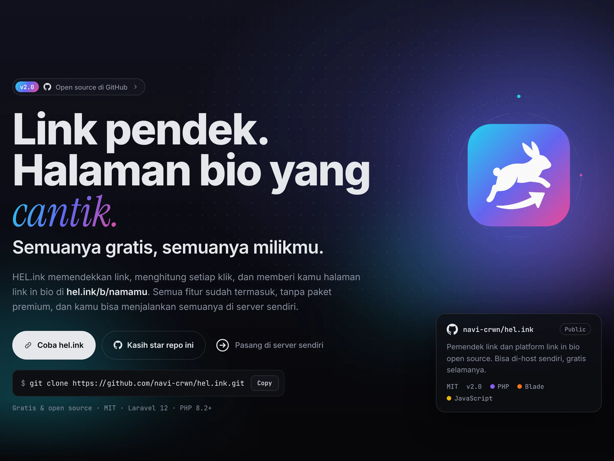
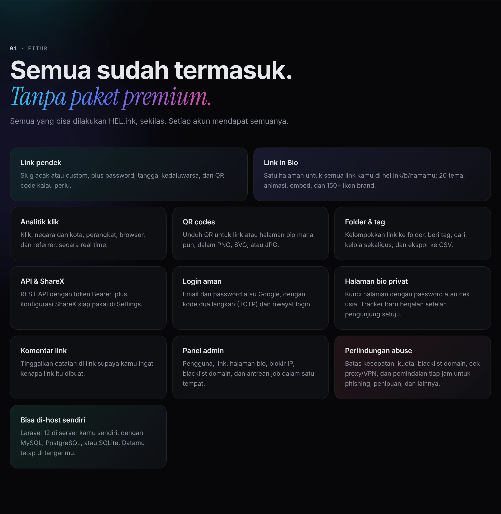
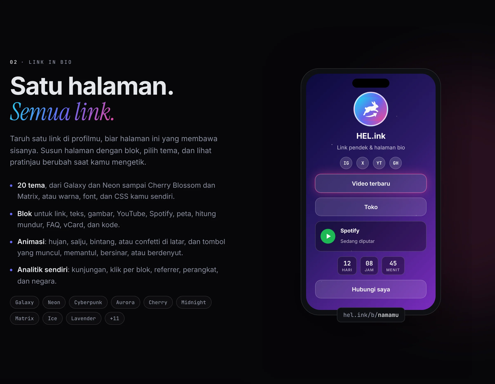

<p align="center"><a href="README.md">English</a> · <b>Bahasa Indonesia</b></p>

<p align="center"><picture><source media="(prefers-color-scheme: light)" srcset="docs/readme/hero-id-light.webp"></picture></p>

<p align="center">
  <b>Pendekkan link, hitung setiap klik, dan punya halaman link in bio.<br>Gratis, open source, dan bisa kamu host sendiri.</b>
</p>

<p align="center">
  <a href="https://hel.ink"><b>🔗 Coba hel.ink</b></a> ·
  <a href="https://navi-crwn.github.io/hel.ink/">Website</a> ·
  <a href="https://hel.ink/b/hel">Contoh bio</a> ·
  <a href="#cara-pasang">Cara pasang</a> ·
  <a href="#api">API</a> ·
  <a href="#pertanyaan-umum">FAQ</a> ·
  <a href="CHANGELOG.md">Changelog</a> ·
  <a href="CREDITS.md">Kredit</a>
</p>

<p align="center">
  
  
  
  
  
</p>

---

## Apa itu HEL.ink?

Link yang panjang susah dibagikan, dan kamu tidak pernah tahu siapa yang mengkliknya. HEL.ink membuatnya **pendek** (bisa dengan slug pilihanmu), **menghitung setiap klik** per negara, perangkat, dan referrer, dan memberi kamu satu **halaman link in bio** di `hel.ink/b/namamu` untuk semua yang ingin kamu tunjukkan.

Semua fitur sudah termasuk untuk setiap akun. Tanpa paket premium, tanpa fitur yang dikunci. Dan karena open source, kamu juga bisa menjalankan semuanya di server dan domain sendiri.

**Cocok untuk kamu yang:**
- sering membagikan link di media sosial dan ingin tahu mana yang berhasil,
- butuh satu halaman rapi untuk semua link, toko, musik, dan video,
- ingin pemendek link yang kamu kendalikan sendiri, di server sendiri.

<p align="center"><picture><source media="(prefers-color-scheme: light)" srcset="docs/readme/features-id-light.webp"></picture></p>

<p align="center"><picture><source media="(prefers-color-scheme: light)" srcset="docs/readme/bio-id-light.webp"></picture></p>

📖 **Tur lengkap, panduan self-host, dan FAQ:** [navi-crwn.github.io/hel.ink](https://navi-crwn.github.io/hel.ink/)

## Fitur

- **🔗 Link pendek.** Slug acak atau custom, password dan tanggal kedaluwarsa opsional, dan QR code (PNG, SVG, atau JPG) untuk setiap link.
- **🙋 Tanpa akun pun bisa.** Siapa saja bisa memendekkan link. Link tamu bertahan sampai 30 hari; daftar untuk menyimpannya dan melihat statistiknya.
- **🪪 Link in Bio.** Halamanmu sendiri di `hel.ink/b/namamu`, disusun dari blok: link, teks, gambar, YouTube, Spotify, peta, hitung mundur, FAQ, vCard, dan potongan kode.
- **🎨 20 tema.** Galaxy, Neon, Cyberpunk, Aurora, Cherry Blossom, Midnight, Matrix, Ice, Lavender, dan lainnya, atau warna, font, dan CSS kamu sendiri. Editornya menampilkan pratinjau langsung.
- **✨ Animasi.** Hujan, salju, bintang, hati, daun, atau confetti di latar halaman; tombol yang muncul, bergeser, memantul, bersinar, berdenyut, atau bergoyang.
- **🏷️ 150+ ikon brand.** Ikon media sosial dari Simple Icons, ditaruh di posisi yang kamu mau.
- **📊 Analitik.** Klik, pengunjung unik, negara dan kota, perangkat, browser, dan referrer, secara real time, dengan ekspor CSV. Halaman bio punya statistik kunjungan dan klik per blok sendiri.
- **🗂️ Folder & tag.** Kelompokkan, beri tag, dan cari link, kelola banyak link sekaligus, dan tinggalkan komentar di link.
- **🔒 Halaman bio privat.** Kunci halaman dengan password atau cek usia. Google Analytics, Facebook Pixel, dan TikTok Pixel baru dimuat setelah pengunjung setuju.
- **🔌 API & ShareX.** REST API dengan token Bearer, plus konfigurasi ShareX siap pakai di Settings → API.
- **🔐 Login aman.** Email dan password atau login Google, kode dua langkah (TOTP), dan riwayat login.
- **🛡️ Perlindungan abuse.** Batas kecepatan dan kuota, blacklist domain, cek proxy/VPN, formulir laporan, dan pemindaian tiap jam untuk phishing, penipuan, dan link berbahaya lainnya, dengan pengecekan Google Safe Browsing dan URLhaus (opsional).
- **🧰 Panel admin.** Pengguna, link, halaman bio, blokir IP, blacklist domain, laporan abuse, dan antrean job dalam satu tempat.
- **🏠 Bisa di-host sendiri.** Laravel 12 di server kamu sendiri dengan MySQL, PostgreSQL, atau SQLite.

## Cara pasang

**Yang kamu butuhkan:** PHP 8.2+, Composer, Node.js 18+, dan database (MySQL 8.0+, PostgreSQL 13+, atau SQLite). Redis opsional, untuk cache.

```bash
# 1. Ambil kodenya
git clone https://github.com/navi-crwn/hel.ink.git
cd hel.ink
composer install && npm install

# 2. Siapkan
cp .env.example .env
php artisan key:generate
php artisan migrate
php artisan storage:link

# 3. Build dan jalankan
npm run build
php artisan serve
```

Lalu buka `http://localhost:8000`.

<details>
<summary><b>Pengaturan di <code>.env</code></b></summary>

**Database**
```env
DB_CONNECTION=mysql
DB_HOST=127.0.0.1
DB_DATABASE=helink
DB_USERNAME=your_user
DB_PASSWORD=your_pass
```

**Email**
```env
MAIL_MAILER=smtp
MAIL_HOST=smtp.gmail.com
MAIL_PORT=587
MAIL_USERNAME=your@email.com
MAIL_PASSWORD=your-app-password
```

**Login Google** (opsional)
```env
GOOGLE_CLIENT_ID=xxx
GOOGLE_CLIENT_SECRET=xxx
GOOGLE_REDIRECT_URI=https://yourdomain.com/auth/google/callback
```

**Domain sendiri:** isi `APP_URL` dengan domainmu, maka semua link pendek dan halaman bio memakainya.

**Production:** biarkan queue worker tetap berjalan.
```bash
php artisan queue:work
```

</details>

## Cara pakai

**Memendekkan link**
1. Tempel URL panjangmu.
2. Opsional: pilih slug custom, password, atau tanggal kedaluwarsa.
3. Tekan **Shorten** dan salin link-nya.

**Membuat halaman bio**
1. Buka **Dashboard → Link in Bio**.
2. Buat halaman dengan namamu.
3. Tambahkan blok: link, teks, gambar, video, musik.
4. Pilih tema dan warnamu.
5. Bagikan: `hel.ink/b/namamu`.

## API

Buat token di **Settings → API**, lalu:

```bash
curl -X POST https://hel.ink/api/shorten \
  -H "Authorization: Bearer YOUR_TOKEN" \
  -H "Content-Type: application/json" \
  -d '{"url": "https://example.com", "alias": "my-link"}'
```

`alias` boleh dikosongkan. Balasannya berisi `url` pendek dan `slug`-nya. Konfigurasi ShareX siap diunduh di **Settings → API**.

## Pertanyaan umum

**Benar-benar gratis?**
Ya. Tidak ada paket berbayar dan tidak ada fitur yang dikunci, dan kodenya berlisensi MIT, jadi kamu boleh menjalankan, mengubah, dan membagikannya.

**Perlu akun?**
Tidak untuk memendekkan link. Link tamu bertahan sampai 30 hari. Dengan akun, link kamu tersimpan, dan kamu dapat analitik, folder, API, dan halaman bio.

**Di mana halaman bio saya?**
Di `hel.ink/b/` lalu nama yang kamu pilih, misalnya [hel.ink/b/hel](https://hel.ink/b/hel).

**Bisa pakai domain sendiri?**
Bisa, dengan meng-host salinan sendiri: isi `APP_URL` di `.env` dengan domainmu.

**Apa yang tercatat dari sebuah klik?**
Waktu, negara dan kota, perangkat, browser, dan referrer. Pixel pelacak di halaman bio baru dimuat setelah pengunjung setuju.

**Bagaimana melaporkan link berbahaya?**
Pakai formulir laporan di hel.ink. Laporan masuk ke halaman Abuse di panel admin, bersama temuan dari pemindaian otomatis.

## Di balik layar

| Lapisan | Teknologi |
|---|---|
| **Backend** | Laravel 12, PHP 8.2+, MySQL / PostgreSQL / SQLite |
| **Frontend** | Tailwind CSS 3, Alpine.js 3, Vite 7 |
| **Grafik & peta** | Chart.js 4, Leaflet 1.9 |
| **Ikon** | Heroicons, Simple Icons (150+ brand) |
| **Auth** | Laravel Breeze, Socialite, Google2FA |
| **Layanan** | Cloudflare Turnstile, IP-API, FlagCDN |

| Folder | Isinya |
|---|---|
| `app/`, `routes/`, `resources/` | Aplikasi Laravel: controller, model, view Blade, dan editor bio. |
| `config/bio-themes.php` | Tema-tema halaman bio. |
| `config/abuse.php`, `config/limits.php` | Pola dan ambang pemindaian abuse, serta kuota link. |
| `tests/` | Tes PHPUnit (`php artisan test`) dan synthetic users Playwright di `tests/e2e/`. |
| `docs/` | Website (GitHub Pages). `docs/readme/` berisi gambar README, diambil dari website dengan `node scripts/readme-images.mjs`. |

Daftar dependensi lengkap: [CREDITS.md](CREDITS.md).

## Berkontribusi

1. Fork repo ini.
2. Buat branch (`git checkout -b feature/cool-thing`).
3. Commit perubahanmu dan jalankan `php artisan test`.
4. Push dan buka pull request.

Ikuti PSR-12 dan tambahkan tes untuk fitur baru.

---

<p align="center">Lisensi MIT · Dibuat oleh <a href="https://github.com/navi-crwn">Ivan Novskies (@navi-crwn)</a> · <a href="https://hel.ink">hel.ink</a> · <a href="https://navi-crwn.github.io/hel.ink/">Website</a></p>
