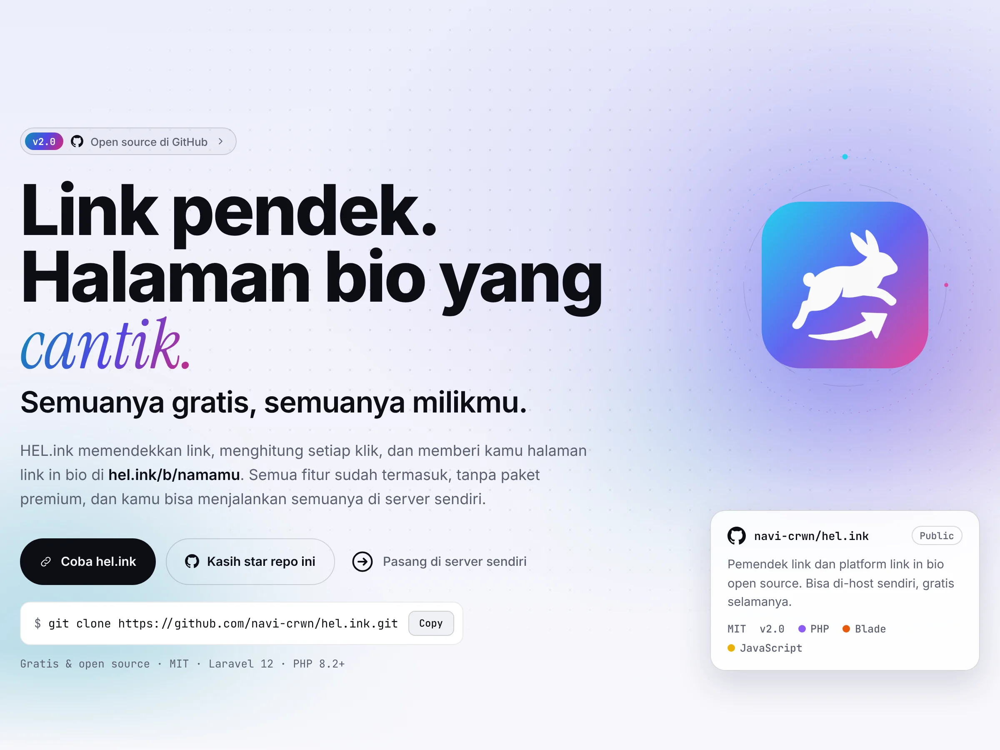

<p align="center">🌐 <a href="README.md">English</a> · <a href="README.zh.md">简体中文</a> · <a href="README.es.md">Español</a> · <a href="README.ar.md">العربية</a> · <a href="README.pt.md">Português</a> · <a href="README.fr.md">Français</a> · <a href="README.ja.md">日本語</a> · <b>Bahasa Indonesia</b></p>

# LinkHop — LinkHop · Pemendek tautan, kode QR & analitik klik

<p align="center">
  <a href="LICENSE"></a>
  <a href="https://github.com/navi-crwn/LinkHop/actions/workflows/tests.yml"></a>
</p>

<p align="center"><picture><source media="(prefers-color-scheme: dark)" srcset="docs/readme/hero-id-dark.webp"></picture></p>

<p align="center"><b>Pendekkan tautan, hitung setiap klik, analisis pengunjung berdasarkan negara dan perangkat, serta lindungi mereka dengan deteksi ancaman otomatis.</b></p>

<p align="center">
  <a href="https://link.hel.ink">link.hel.ink</a> ·
  <a href="#run">Pasang sendiri</a> ·
  <a href="#features">Fitur</a> ·
  <a href="#faq">FAQ</a> ·
  <a href="#family">Keluarga HOP</a>
</p>

---

## Pemendek Tautan HOP

Pemendek tautan cepat dan menjaga privasi dengan slug kustom, kode QR, analitik mendalam, dan pemindaian ancaman. Bagian dari keluarga HOP.

<a id="features"></a>

## Fitur Utama

Beranda menghadirkan kembali pulau dan kelinci 3D interaktif. Gerakkan penunjuk atau sentuh pulau, pilih skenario berbagi dan kata sandi, atau jeda gerakan. Tur dengan gulir dan tombol menyediakan demo slug, perlindungan kata sandi, dan analitik lokal tanpa membuat data. Pemendek tautan sungguhan tetap tersedia di atas, dengan dukungan ponsel dan pengurangan gerakan.

- **Pemendekan Secepat Kilat**: Slug kustom atau ID acak disajikan seketika di hel.ink/l/{slug} dengan latensi rendah.
- **Kode QR Dinamis**: Buat kode QR SVG/PNG resolusi tinggi untuk cetak, kemasan, maupun berbagi digital.
- **Analitik Klik Mendalam**: Pantau negara pengunjung (GeoIP), perangkat, peramban, sistem operasi, dan perujuk secara langsung.
- **Keamanan Ancaman Otomatis**: Pemindaian proaktif melalui hop/safety dan daftar hitam domain bersama demi melindungi pengunjung.
- **Kontrol Tautan Granular**: Atur tanggal kedaluwarsa, batas jumlah klik, dan proteksi kata sandi untuk tujuan sensitif.
- **Pengelompokan & Tag**: Kelompokkan tautan ke dalam folder dan beri tag kampanye untuk kemudahan pengelolaan.
- **Single Sign-On HOP ID**: Masuk sekali dengan HOP ID terpusat; tanpa akun ganda atau sesi terpisah.
- **API REST Pengembang**: API lengkap dengan autentikasi token berlingkup untuk pembuatan dan pemantauan tautan terprogram.

<a id="run"></a>

## Pasang LinkHop sendiri

LinkHop berjalan di atas infrastruktur PHP dan Laravel modern standar.

```bash
git clone https://github.com/navi-crwn/LinkHop.git
cd LinkHop
composer install
cp .env.example .env && php artisan key:generate
php artisan migrate
npm install && npm run build
php artisan serve
```

<a id="faq"></a>

## Pertanyaan yang sering diajukan

**Apa yang terjadi pada halaman link-in-bio?**
Halaman bio telah dipisahkan menjadi BioHop (bio.hel.ink) sebagai aplikasi khusus yang kaya fitur. Tautan bio lama otomatis dialihkan.

**Bisakah saya memakai slug kustom?**
Ya, pengguna yang masuk dapat memilih slug kustom untuk tautan apa pun selama masih tersedia.

**Bagaimana pelacakan klik menjaga privasi?**
Klik diagregasi tanpa menyimpan data pribadi mentah atau menjual profil pengguna, dan log dibersihkan secara rutin.

**Apakah LinkHop gratis dan open source?**
Ya, LinkHop dirilis di bawah lisensi MIT yang bebas untuk digunakan dan dihosting mandiri oleh siapa saja.

<a id="family"></a>

## Keluarga HOP

LinkHop adalah bagian dari keluarga aplikasi web open-source HOP yang dapat dipasang mandiri.

| Aplikasi | Alamat langsung | Kode | Kegunaan |
| --- | --- | --- | --- |
| **HOP ID** | `hel.ink` · `hub.hel.ink` | [navi-crwn/HEL.ink](https://github.com/navi-crwn/HEL.ink) | Portal akun, login HOP ID |
| **LinkHop** | `link.hel.ink` · `hel.ink/l/…` | repo ini | Pemendek tautan, kode QR & analitik |
| **BioHop** | `bio.hel.ink` · `hel.ink/b/…` | [navi-crwn/BioHop](https://github.com/navi-crwn/BioHop) | Halaman link-in-bio dan tema |
| **PixelHop** | `pixel.hel.ink` · `p.hel.ink/…` | [navi-crwn/PixelHop](https://github.com/navi-crwn/PixelHop) | Hosting gambar dan media |
| **NoteHop** | `note.hel.ink` · `n.hel.ink/…` | [navi-crwn/NoteHop](https://github.com/navi-crwn/NoteHop) | Catatan privat terenkripsi klien |

<a id="security"></a>

## Bantuan & Dukungan

Menemukan bug atau butuh bantuan? Buka isu di <a href="https://github.com/navi-crwn/LinkHop/issues">GitHub Issues</a>atau kirimkan pull request.

---

<p align="center"><sub>LinkHop · bagian dari keluarga HOP · <a href="https://link.hel.ink">link.hel.ink</a></sub></p>
