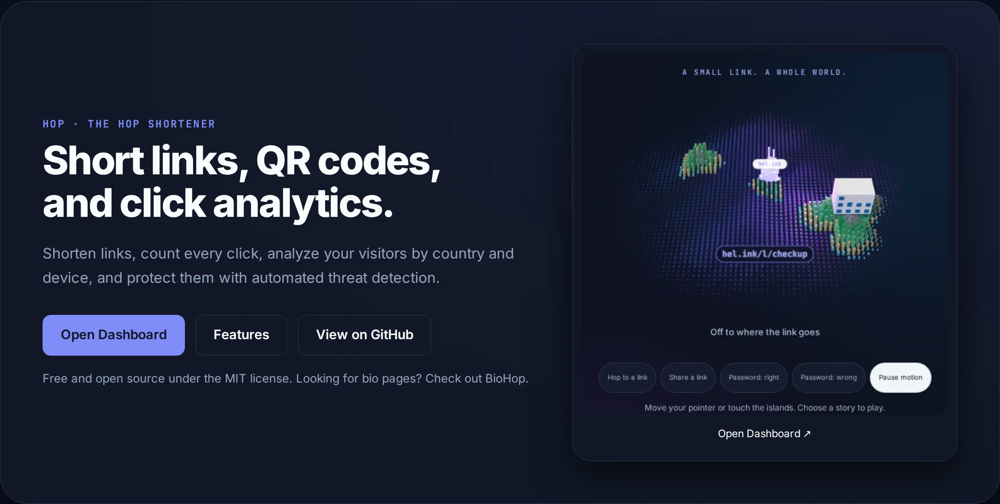
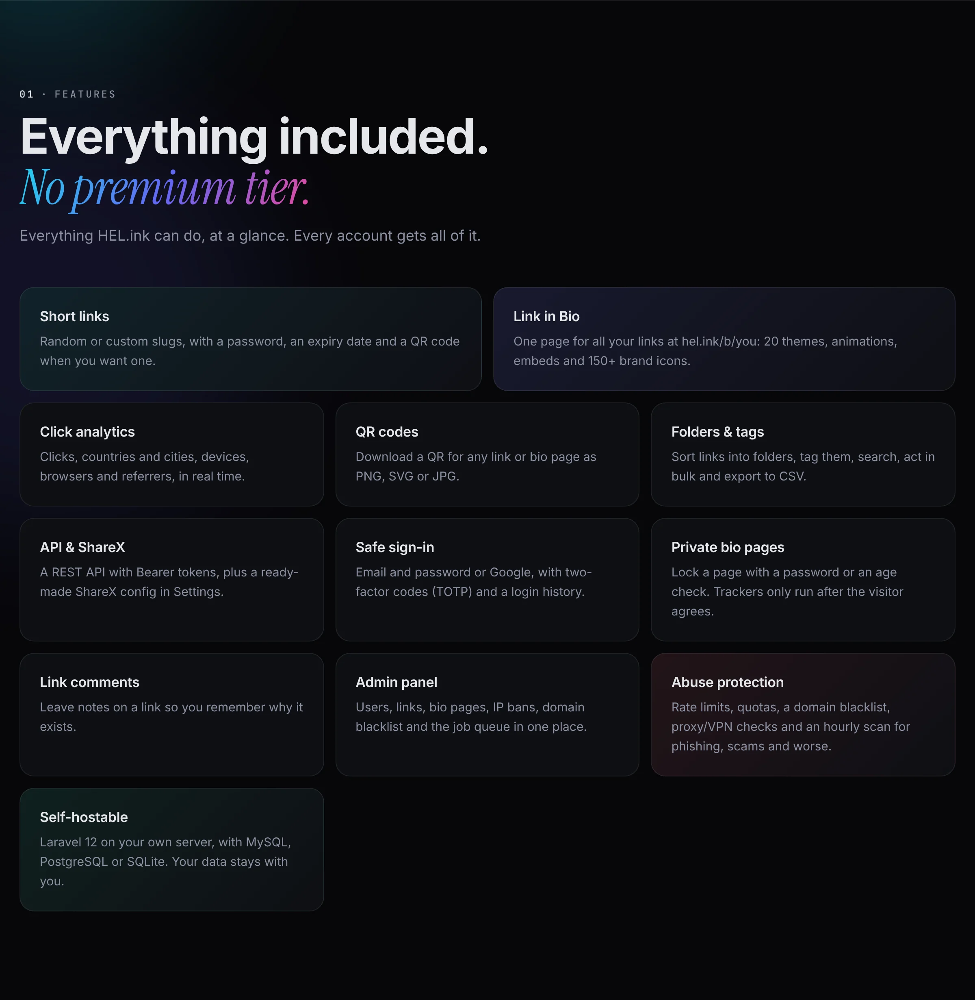
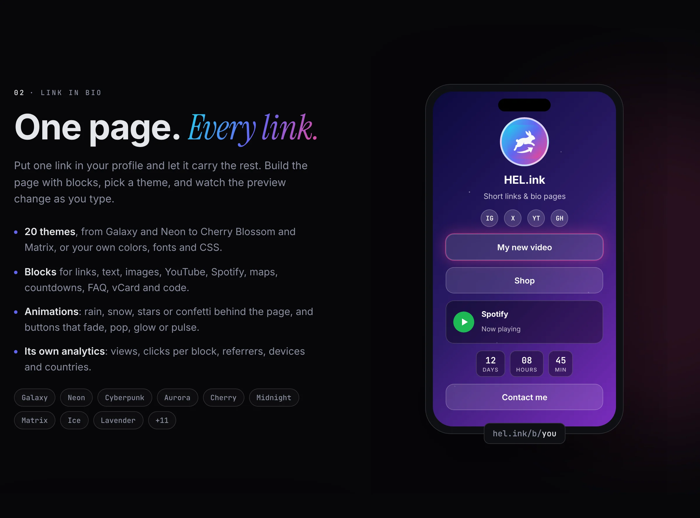
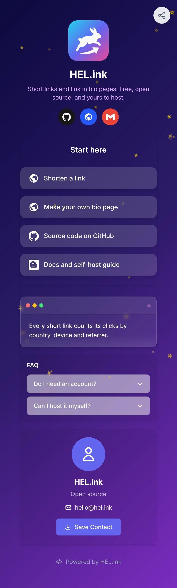

<p align="center"><b>English</b> · <a href="README.id.md">Bahasa Indonesia</a></p>

<p align="center"><picture><source media="(prefers-color-scheme: light)" srcset="docs/readme/hero-en-light.webp"></picture></p>

<p align="center">
  <b>Shorten links, count every click, and get a link in bio page.<br>Free, open source, and yours to host.</b>
</p>

<p align="center">
  <a href="https://hel.ink"><b>🔗 Try hel.ink</b></a> ·
  <a href="https://navi-crwn.github.io/hel.ink/">Website</a> ·
  <a href="https://hel.ink/b/hel">Bio example</a> ·
  <a href="#install">Install</a> ·
  <a href="#api">API</a> ·
  <a href="#faq">FAQ</a> ·
  <a href="CHANGELOG.md">Changelog</a> ·
  <a href="CREDITS.md">Credits</a>
</p>

<p align="center">
  
  
  
  
  
</p>

---

## What is LinkHop?

**LinkHop** is the link shortener of the HOP family, at **hel.ink** ("Hop Easy Link"). One HOP ID signs you in to LinkHop, [PixelHop](https://github.com/navi-crwn/pixelhop) (images) and [NoteHop](https://github.com/navi-crwn/NoteHop) (notes).

Long links are hard to share and you never know who clicks them. LinkHop makes them **short** (with your own slug if you like), **counts every click** by country, device and referrer, and gives you one **link in bio page** at `hel.ink/b/you` for everything you want people to find.

Everything is included for every account. No premium tier, no locked features. And because it's open source, you can also run the whole thing on your own server and your own domain.

**Good for you if you:**
- share links on social media and want to see what works,
- need one tidy page for all your links, shop, music and videos,
- want a link shortener you control, on your own server.

<p align="center"><picture><source media="(prefers-color-scheme: light)" srcset="docs/readme/features-en-light.webp"></picture></p>

<p align="center"><picture><source media="(prefers-color-scheme: light)" srcset="docs/readme/bio-en-light.webp"></picture></p>

📖 **The full tour, the self-host guide and the FAQ:** [navi-crwn.github.io/hel.ink](https://navi-crwn.github.io/hel.ink/)

## Example



**Bio page:** [hel.ink/b/hel](https://hel.ink/b/hel), LinkHop's own page with the Galaxy theme, link buttons with brand icons, a text block, an FAQ and a contact card.

**Short links:**

| Short link | Goes to |
| --- | --- |
| [hel.ink/github](https://hel.ink/github) | The source code |
| [hel.ink/website](https://hel.ink/website) | The website |
| [hel.ink/selfhost](https://hel.ink/selfhost) | The self-host guide |
| [hel.ink/documentation](https://hel.ink/documentation) | The API reference |
| [hel.ink/changelog](https://hel.ink/changelog) | What changed in each release |

To load the same example on your own install, run `php artisan db:seed --class=ExampleBioSeeder`.

<br clear="right">

## Features

- **🔗 Short links.** Random or custom slugs, an optional password and expiry date, and a QR code (PNG, SVG or JPG) for every link.
- **🙋 No account needed.** Anyone can shorten a link. Guest links are deleted after 14 days without a click, and after 30 days at most; sign up to keep them and see their stats.
- **🪪 Link in Bio.** Your own page at `hel.ink/b/you`, built from blocks: links, text, images, YouTube, Spotify, maps, countdowns, FAQ, vCard and code snippets.
- **🎨 20 themes.** Galaxy, Neon, Cyberpunk, Aurora, Cherry Blossom, Midnight, Matrix, Ice, Lavender and more, or your own colors, fonts and custom CSS. The editor shows a live preview.
- **✨ Animations.** Rain, snow, stars, hearts, leaves or confetti behind the page; buttons that fade, slide, pop, glow, pulse or wiggle.
- **🏷️ 150+ brand icons.** Social icons from Simple Icons, placed where you want them.
- **📊 Analytics.** Clicks, unique visitors, countries and cities, devices, browsers and referrers, in real time, with CSV export. Bio pages get their own views and clicks per block.
- **🗂️ Folders & tags.** Sort, tag and search your links, act on many at once, and leave comments on a link.
- **🔒 Private bio pages.** Lock a page with a password or an age check. Google Analytics, Facebook Pixel and TikTok Pixel only load after the visitor agrees.
- **🔌 API & ShareX.** A REST API with Bearer tokens, plus a ready-made ShareX config in Settings → API.
- **🔐 Safe sign-in.** Email and password or Google login, two-factor codes (TOTP) and a login history.
- **🛡️ Abuse protection.** Rate limits and quotas, a domain blacklist, proxy/VPN checks, a report form, and an hourly scan for phishing, scams and other harmful links, with optional Google Safe Browsing and URLhaus lookups.
- **🧰 Admin panel.** Users, links, bio pages, IP bans, the domain blacklist, abuse reports and the job queue in one place.
- **🏠 Self-hostable.** Laravel 12 on your own server with MySQL, PostgreSQL or SQLite.

## Install

**You need:** PHP 8.2+, Composer, Node.js 18+ and a database (MySQL 8.0+, PostgreSQL 13+ or SQLite). Redis is optional, for caching.

```bash
# 1. Get the code
git clone https://github.com/navi-crwn/hel.ink.git
cd hel.ink
composer install && npm install

# 2. Set it up
cp .env.example .env
php artisan key:generate
php artisan migrate
php artisan storage:link

# 3. Build and run
npm run build
php artisan serve
```

Then open `http://localhost:8000`.

<details>
<summary><b>Settings in <code>.env</code></b></summary>

**Database**
```env
DB_CONNECTION=mysql
DB_HOST=127.0.0.1
DB_DATABASE=helink
DB_USERNAME=your_user
DB_PASSWORD=your_pass
```

**Email**
```env
MAIL_MAILER=smtp
MAIL_HOST=smtp.gmail.com
MAIL_PORT=587
MAIL_USERNAME=your@email.com
MAIL_PASSWORD=your-app-password
```

**Google login** (optional)
```env
GOOGLE_CLIENT_ID=xxx
GOOGLE_CLIENT_SECRET=xxx
GOOGLE_REDIRECT_URI=https://yourdomain.com/auth/google/callback
```

**Your own domain:** set `APP_URL` to it, and every short link and bio page uses it.

**Behind Cloudflare:** LinkHop sends a strict, report-only Content Security Policy that only trusts scripts carrying the page's nonce, and logs what it would block to `storage/logs/csp-*.log`. Cloudflare's **Email Address Obfuscation** (Scrape Shield) and **Rocket Loader** (Speed → Optimization) inject their own scripts from `/cdn-cgi/scripts/.../cloudflare-static/` without that nonce, so they fill the log. Either turn them off in the Cloudflare dashboard (recommended: LinkHop doesn't need them, and it keeps the policy ready to enforce), or skip them only where needed with a Cloudflare Configuration Rule. Allowing them in the policy doesn't work with a nonce policy (`'strict-dynamic'` ignores host and `'self'` allowlists); it would mean dropping the nonce, which weakens the policy for everything else.

**Production:** keep a queue worker running.
```bash
php artisan queue:work
```

</details>

## How to use it

**Shorten a link**
1. Paste your long URL.
2. Optional: pick a custom slug, a password or an expiry date.
3. Press **Shorten** and copy your link.

**Make a bio page**
1. Go to **Dashboard → Link in Bio**.
2. Create a page with your name.
3. Add blocks: links, text, images, videos, music.
4. Pick a theme and your colors.
5. Share it: `hel.ink/b/yourname`.

## API

Make a token in **Settings → API**, then:

```bash
curl -X POST https://hel.ink/api/shorten \
  -H "Authorization: Bearer YOUR_TOKEN" \
  -H "Content-Type: application/json" \
  -d '{"url": "https://example.com", "alias": "my-link"}'
```

`alias` is optional. The reply holds the short `url` and its `slug`. A ShareX config is ready to download in **Settings → API**.

## FAQ

**Is it really free?**
Yes. There's no paid plan and no locked feature, and the code is MIT licensed, so you can run, change and share it.

**Do I need an account?**
Not to shorten a link. Guest links are deleted after 14 days without a click, and after 30 days at most. With an account you keep your links and get analytics, folders, the API and a bio page.

**Where is my bio page?**
At `hel.ink/b/` followed by the name you pick, for example [hel.ink/b/hel](https://hel.ink/b/hel).

**Can I use my own domain?**
Yes, by hosting your own copy: set `APP_URL` in `.env` to your domain.

**What does a click record?**
The time, country and city, device, browser and referrer. Tracking pixels on bio pages only load after the visitor agrees.

**How do I report a bad link?**
Use the report form on hel.ink. Reports land on the admin Abuse page, next to the findings of the automatic scan.

## Under the hood

| Layer | Technologies |
|---|---|
| **Backend** | Laravel 12, PHP 8.2+, MySQL / PostgreSQL / SQLite |
| **Frontend** | Tailwind CSS 4, Alpine.js 3, Vite 7 |
| **Charts & maps** | Chart.js 4, Leaflet 1.9 |
| **Icons** | Heroicons, Simple Icons (150+ brands) |
| **Auth** | Laravel Breeze, Socialite, Google2FA |
| **Services** | Cloudflare Turnstile, IP-API, FlagCDN |

| Folder | What's in it |
|---|---|
| `app/`, `routes/`, `resources/` | The Laravel app: controllers, models, Blade views and the bio editor. |
| `config/bio-themes.php` | The bio page themes. |
| `config/abuse.php`, `config/limits.php` | Abuse scan patterns and thresholds, and link quotas. |
| `tests/` | PHPUnit tests (`php artisan test`) and the Playwright synthetic users in `tests/e2e/`. |
| `docs/` | The website (GitHub Pages). `docs/readme/` holds the README images, drawn from the website with `node scripts/readme-images.mjs`. |

Full dependency list: [CREDITS.md](CREDITS.md).

## Contributing

1. Fork the repo.
2. Create a branch (`git checkout -b feature/cool-thing`).
3. Commit your changes and run `php artisan test`.
4. Push and open a pull request.

Please follow PSR-12 and add tests for new features.

---

<p align="center">MIT License · Made by <a href="https://github.com/navi-crwn">Ivan Novskies (@navi-crwn)</a> · <a href="https://hel.ink">hel.ink</a> · <a href="https://navi-crwn.github.io/hel.ink/">Website</a></p>
