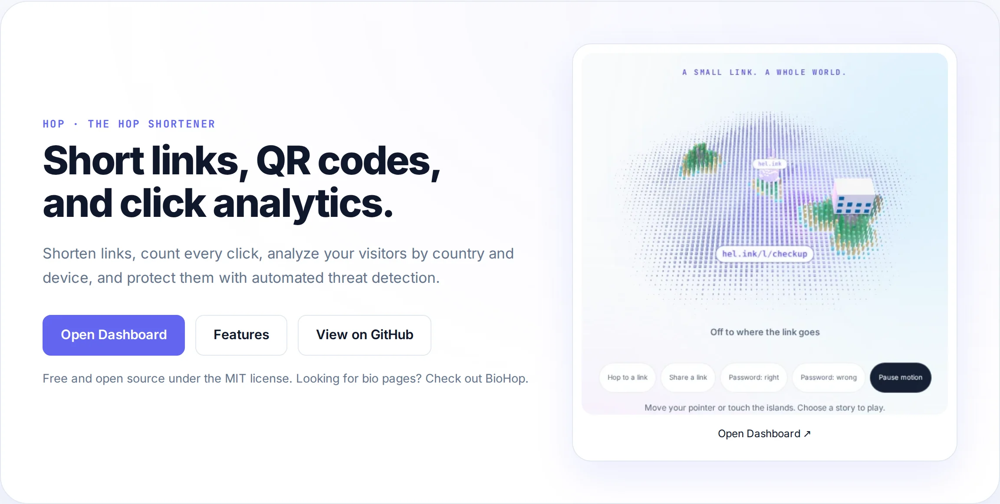

<p align="center">🌐 <a href="README.md">English</a> · <a href="README.zh.md">简体中文</a> · <a href="README.es.md">Español</a> · <a href="README.ar.md">العربية</a> · <b>Português</b> · <a href="README.fr.md">Français</a> · <a href="README.ja.md">日本語</a> · <a href="README.id.md">Bahasa Indonesia</a></p>

# LinkHop — LinkHop · Links curtos, códigos QR e análise de cliques

<p align="center">
  <a href="LICENSE"></a>
  <a href="https://github.com/navi-crwn/LinkHop/actions/workflows/tests.yml"></a>
</p>

<p align="center"><picture><source media="(prefers-color-scheme: dark)" srcset="docs/readme/hero-en-dark.webp"></picture></p>

<p align="center"><b>Encurte URLs, monitore cliques, analise seus visitantes por país e dispositivo e proteja seu público com verificação automática de ameaças.</b></p>

<p align="center">
  <a href="https://link.hel.ink">link.hel.ink</a> ·
  <a href="#run">Hospede você mesmo</a> ·
  <a href="#features">Recursos</a> ·
  <a href="#faq">FAQ</a> ·
  <a href="#family">Família HOP</a>
</p>

---

## O encurtador de links HOP

Encurtador de links rápido e focado em privacidade, com slugs personalizados, códigos QR, estatísticas e proteção contra ameaças.

<a id="features"></a>

## Recursos

- **Encurtamento ultrarrápido**: Slugs personalizados ou identificadores instantâneos em hel.ink/l/{slug} com baixa latência.
- **Códigos QR dinâmicos**: Crie códigos QR em alta resolução nos formatos SVG e PNG prontos para impressão ou compartilhamento.
- **Análise detalhada de cliques**: Acompanhe países de origem (GeoIP), aparelhos, navegadores, sistemas operacionais e referenciadores em tempo real.
- **Proteção automatizada contra ameaças**: Verificação proativa via hop/safety e listas de bloqueio compartilhadas para manter seus usuários seguros.
- **Controles avançados de links**: Defina prazos de expiração, limites de cliques e proteção por senha para destinos confidenciais.
- **Pastas e marcadores**: Agrupe seus links em pastas e use tags para monitorar campanhas de marketing com relatórios consolidados.
- **Logon único com HOP ID**: Conecte-se com seu login central HOP ID sem precisar gerenciar contas adicionais.
- **API REST para desenvolvedores**: API completa com autenticação por tokens para criar e acompanhar links de forma programática.

<a id="run"></a>

## Execute seu próprio LinkHop

O LinkHop funciona em uma infraestrutura moderna em PHP e Laravel.

```bash
git clone https://github.com/navi-crwn/LinkHop.git
cd LinkHop
composer install
cp .env.example .env && php artisan key:generate
php artisan migrate
npm install && npm run build
php artisan serve
```

<a id="faq"></a>

## Perguntas frequentes

**O que aconteceu com as páginas link-in-bio?**
O recurso de bio evoluiu para um aplicativo independente e dedicado chamado BioHop (bio.hel.ink). Links antigos continuam redirecionando normalmente.

**Posso usar palavras personalizadas nos links?**
Sim, usuários conectados podem escolher o slug personalizado que preferirem, desde que esteja livre.

**Como as estatísticas respeitam a privacidade?**
Os dados são computados de forma agregada e anônima, sem venda de perfis, e os registros brutos são limpos rotineiramente.

**O LinkHop é gratuito e de código aberto?**
Sim, o LinkHop é distribuído sob a permissiva licença MIT.

<a id="family"></a>

## A família HOP

O LinkHop faz parte da família HOP de aplicativos web abertos e auto-hospedáveis.

| Aplicativo | Endereço ativo | Código | O que faz |
| --- | --- | --- | --- |
| **HOP ID** | `hel.ink` · `hub.hel.ink` | [navi-crwn/HEL.ink](https://github.com/navi-crwn/HEL.ink) | Portal de contas, login HOP ID |
| **LinkHop** | `link.hel.ink` · `hel.ink/l/…` | este repositório | Links curtos, códigos QR e estatísticas |
| **BioHop** | `bio.hel.ink` · `hel.ink/b/…` | [navi-crwn/BioHop](https://github.com/navi-crwn/BioHop) | Páginas de link-in-bio e temas |
| **PixelHop** | `pixel.hel.ink` · `p.hel.ink/…` | [navi-crwn/PixelHop](https://github.com/navi-crwn/PixelHop) | Hospedagem de imagens e mídia |
| **NoteHop** | `note.hel.ink` · `n.hel.ink/…` | [navi-crwn/NoteHop](https://github.com/navi-crwn/NoteHop) | Notas privadas com criptografia no cliente |

<a id="security"></a>

## Ajuda e suporte

Encontrou um problema ou precisa de ajuda? Abra uma issue no <a href="https://github.com/navi-crwn/LinkHop/issues">GitHub Issues</a>ou envie uma pull request.

---

<p align="center"><sub>LinkHop · parte da família HOP · <a href="https://link.hel.ink">link.hel.ink</a></sub></p>
